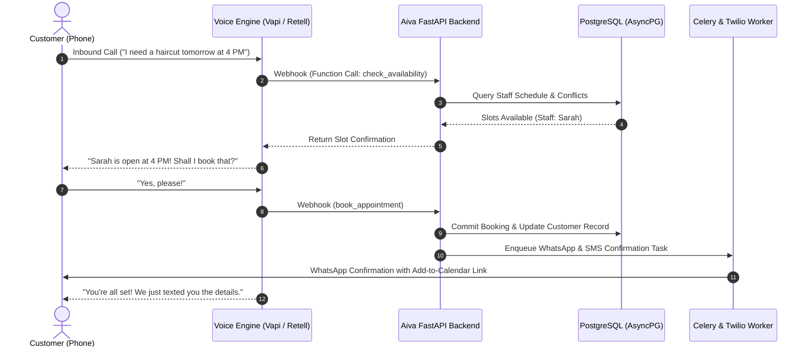

<p align="center">
  <h1 align="center">🤖 Aiva</h1>
  <p align="center">
    <strong>Autonomous Voice AI Receptionist & Appointment Automation SaaS for High-Touch Businesses</strong>
  </p>
</p>

<p align="center">
  <a href="#overview">Overview</a> •
  <a href="#core-capabilities">Features</a> •
  <a href="#industry-verticals">Verticals</a> •
  <a href="#voice-architecture">Architecture</a> •
  <a href="#tech-stack">Tech Stack</a> •
  <a href="#quickstart">Quickstart</a> •
  <a href="#api--webhooks">Webhooks</a> •
  <a href="#license">License</a>
</p>

<p align="center">
  
  
  
  
  
  
  
  
</p>

---

## 📖 Overview

**Aiva** is an enterprise-grade, multi-tenant autonomous voice receptionist engineered for salons, spas, aesthetic clinics, luxury gyms, and high-touch small businesses. Serving as a relentless front-desk orchestrator, Aiva answers inbound telephone inquiries 24/7, cross-checks therapist or stylist calendars in real time, schedules bookings, and sends omni-channel confirmations over WhatsApp and SMS.

Built on an asynchronous microservice architecture powered by **FastAPI**, **SQLAlchemy (asyncpg)**, and pluggable **Voice AI pipelines (Vapi / Retell)**, Aiva delivers human-like conversational fluidity, eliminates missed calls, and protects revenue with intelligent no-show predictive scoring.

---

## ✨ Core Capabilities

- **📞 24/7 Conversational Voice Receptionist**: Sub-second conversational responses powered by ultra-low-latency voice streaming, handling scheduling, rescheduling, cancellations, and pricing FAQs.
- **📅 Real-Time Calendar Orchestration**: Concurrency-safe slot locking and provider assignment with zero double-booking risk.
- **👥 Intelligent Customer CRM & Reliability Scoring**: Automatically logs caller frequency, service history, lifetime spend, and assigns **Customer Reliability Scores** to preemptively mitigate no-shows.
- **📲 Omni-Channel Automated Dispatch**: Instant booking confirmations, reminders, and calendar links dispatched via **Twilio SMS/WhatsApp** and **SendGrid Email**.
- **🚨 Graceful Human Escalation**: Automatically detects distressed callers, VIP requests, or complex multi-service inquiries and initiates seamless warm transfers to human managers with transcribed context.
- **📊 Business Intelligence Dashboard**: Interactive Recharts analytics tracking caller intent distribution, conversion rates, peak calling hours, and staff utilization.
- **🔒 Enterprise Multi-Tenancy**: Isolated database schemas with role-based access control (Admin, Manager, Receptionist) and customizable business hours/holiday matrices.

---

## 🏛️ Voice & Booking Architecture



---

## 🏢 Tailored for High-Touch Verticals

| Vertical | Custom Specializations |
| :--- | :--- |
| **Luxury Salons & Spas** | Treatment bundles, stylist matching, skin patch test warnings, deposit collection. |
| **Dental & Aesthetic Clinics** | Medical intake reminders, consultation screening, doctor specialization routing. |
| **Fitness & Luxury Gyms** | Trainer slot booking, trial pass onboarding, member verification. |
| **Professional Services** | Initial intake screening, retainer consultation booking, automated Zoom link dispatch. |

---

## 💻 Tech Stack

| Layer | Technology | Purpose |
| :--- | :--- | :--- |
| **Frontend** | React 19, TypeScript, Vite 8 | Single-page SaaS administrative portal |
| **UI & Charts** | Tailwind CSS v4, Lucide React, Recharts | Glassmorphic responsive analytics & control deck |
| **Backend API** | FastAPI, Uvicorn, Pydantic v2 | High-concurrency async REST & webhook router |
| **Database** | PostgreSQL 16 via SQLAlchemy & AsyncPG | ACID-compliant relational ledger with connection pooling |
| **Cache & Queues**| Redis 7 & Celery | Distributed background job queue for notifications |
| **Voice Pipelines**| Vapi AI / Retell AI (Pluggable) | Real-time WebRTC/SIP voice conversational engine |
| **Notifications** | Twilio (WhatsApp & SMS), SendGrid | Transactional customer communication channels |
| **Deployment** | Docker & Docker Compose | Containerized local and production orchestration |

---

## 📂 Project Structure

```text
Aiva/
├── frontend/                     # React 19 SaaS Dashboard
│   ├── src/
│   │   ├── components/           # Reusable UI controls, tables & navigation
│   │   ├── features/             # Business modules
│   │   │   ├── dashboard/        # Revenue, call analytics & KPI trends
│   │   │   ├── appointments/     # Interactive booking grid & calendar
│   │   │   ├── customers/        # CRM profiles & reliability scoring
│   │   │   ├── calls/            # Full audio transcripts & recordings
│   │   │   └── settings/         # Business hours & voice prompt configuration
│   │   └── lib/                  # Axios API client & date utilities
│   ├── package.json
│   └── vite.config.ts
├── backend/                      # FastAPI Microservice
│   ├── app/
│   │   ├── api/                  # REST endpoints & external webhooks
│   │   │   ├── v1/               # Business resources
│   │   │   └── webhooks/         # Vapi & Retell streaming function calls
│   │   ├── core/                 # JWT security, config, database engine
│   │   ├── models/               # SQLAlchemy async models
│   │   ├── schemas/              # Pydantic validation contracts
│   │   ├── services/             # Booking engines, slot resolvers, analytics
│   │   ├── voice/                # Pluggable voice provider abstraction layer
│   │   └── notifications/        # Twilio & SendGrid async workers
│   ├── requirements.txt
│   └── main.py
├── docker-compose.yml            # Local dev stack (Postgres + Redis)
└── README.md                     # Documentation
```

---

## 🚀 Quickstart

### Prerequisites
- **Node.js** >= 20.x
- **Python** >= 3.12
- **Docker & Docker Compose**

### 1. Launch Supporting Services
```bash
docker compose up -d db redis
```

### 2. Backend Setup
```bash
cd backend
python3 -m venv venv
source venv/bin/activate

pip install -r requirements.txt
cp ../.env.example .env

# Run database migrations and launch server
uvicorn app.main:app --reload --port 8000
```
Open Swagger API docs: **`http://localhost:8000/docs`**

### 3. Frontend Setup
```bash
cd ../frontend
npm install
npm run dev
```
Open **`http://localhost:5173`** to access the Aiva administration console.

---

## 🔌 Webhook Integration

Configure your Voice AI provider webhook URL to pipe caller intents into Aiva:

- **Vapi AI Webhook**: `POST https://api.yourdomain.com/api/v1/webhooks/vapi/{business_id}`
- **Retell AI Webhook**: `POST https://api.yourdomain.com/api/v1/webhooks/retell/{business_id}`

---

## 📄 License

Distributed under the **MIT License**.

<p align="center">
  Engineered with ❤️ by <a href="https://github.com/itsgoksz">itsgoksz</a>
</p>
