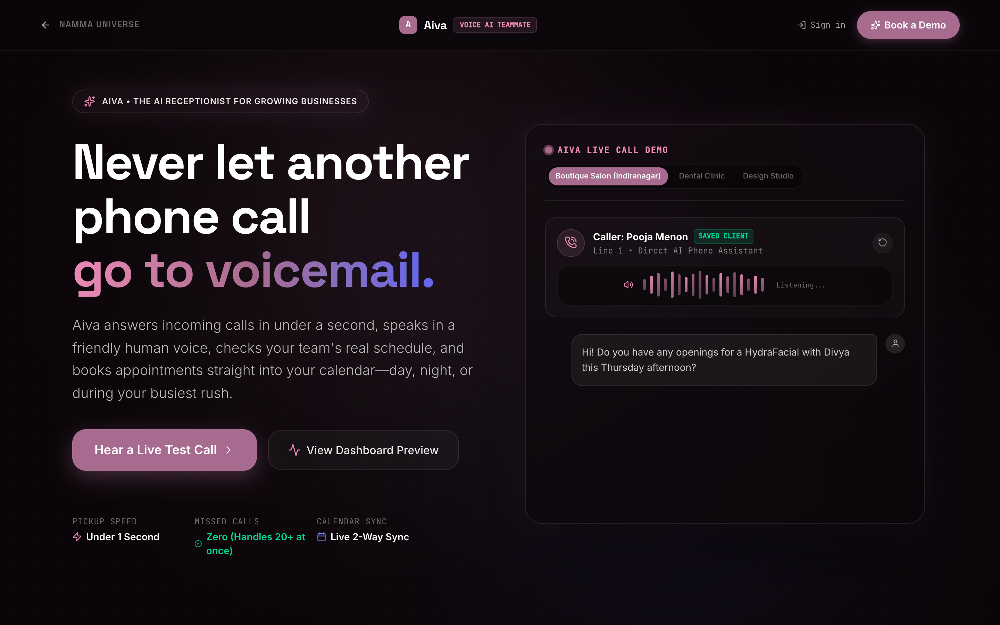
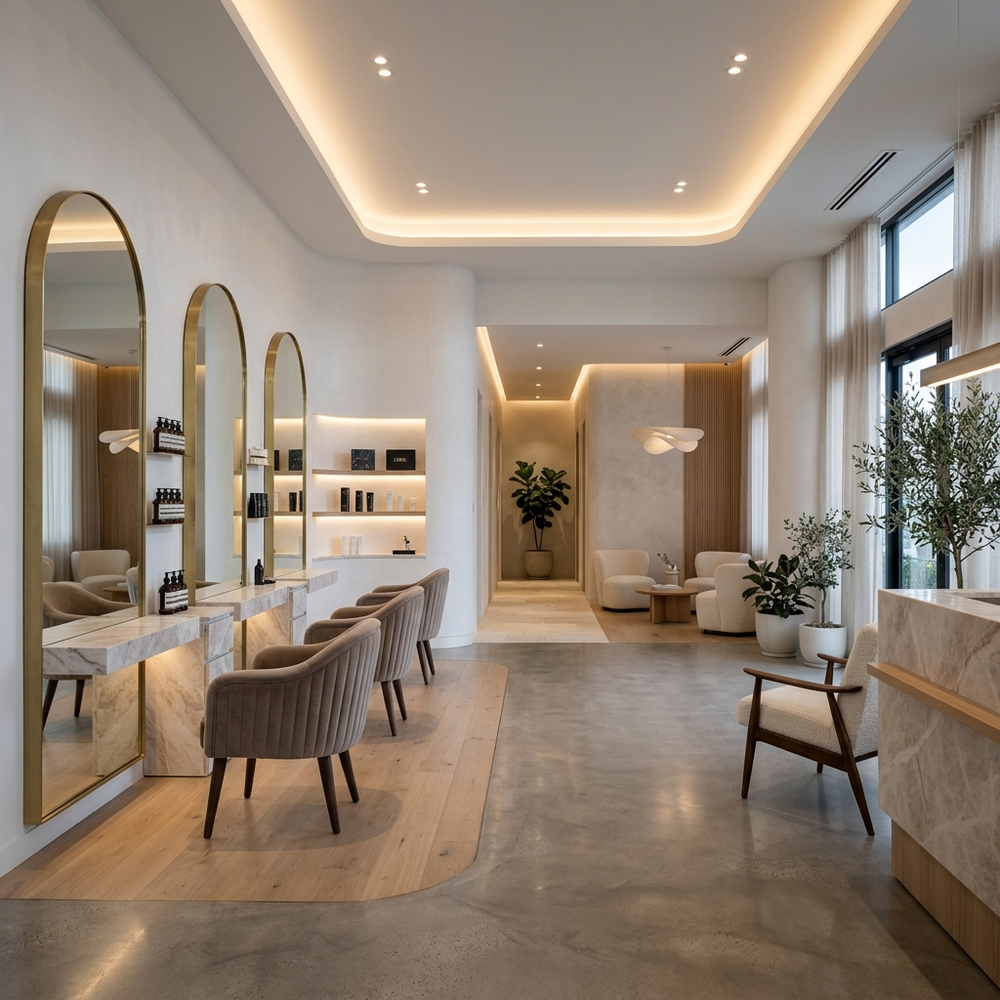
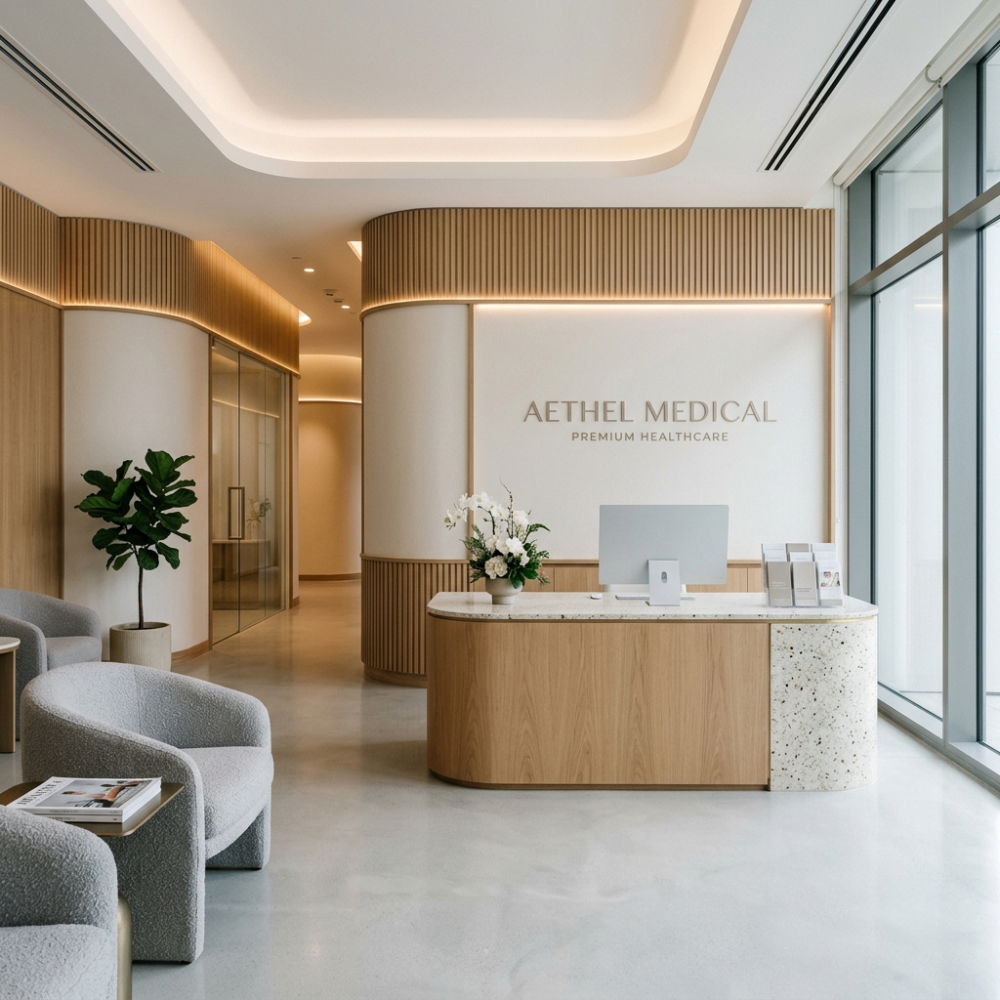
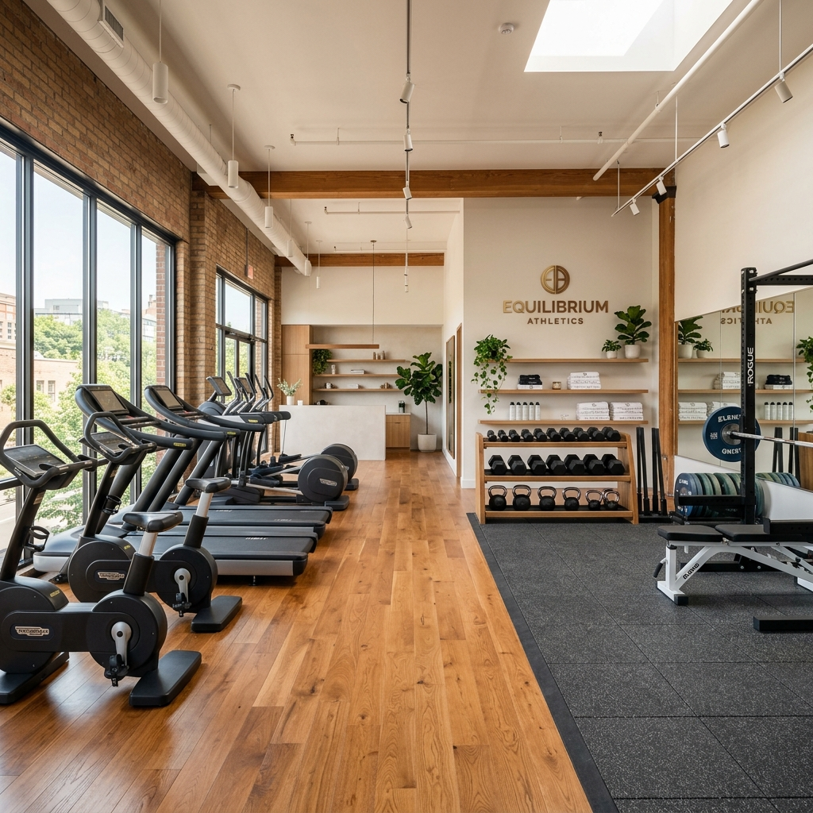
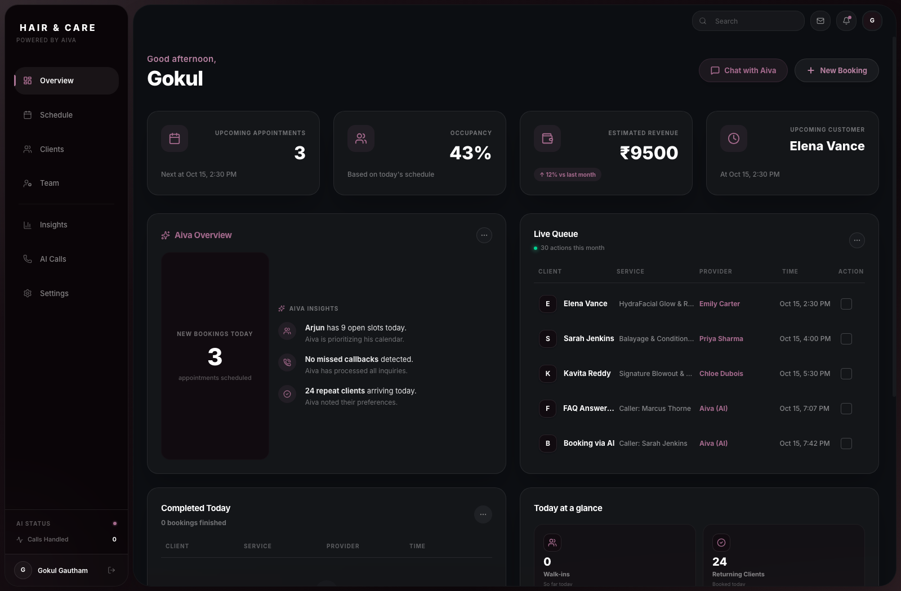
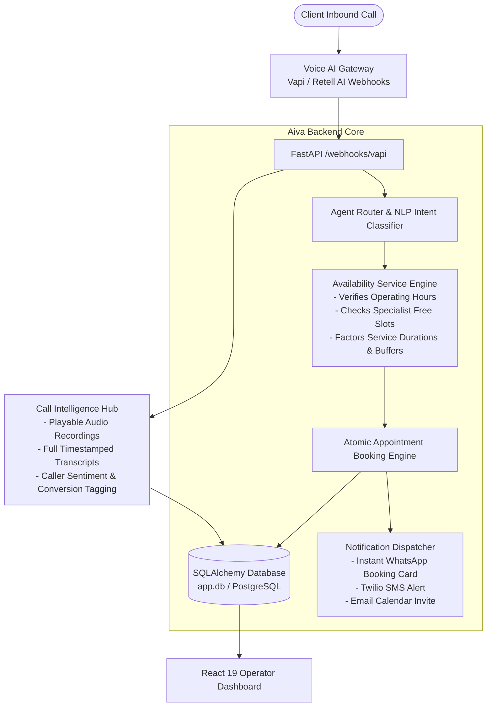

<p align="center">
  
</p>

# 🤖 Aiva

> **Autonomous voice AI receptionist & appointment booking platform for high-touch businesses.** Answers inbound client phone calls 24/7 in natural voice, cross-checks real specialist calendars, prevents double-booking, and texts instant confirmations.

<p align="center">
  
</p>

---

## ⚡ The High-Touch Business Dilemma

For appointment-driven businesses—luxury salons, aesthetic medical clinics, wellness spas, and boutique fitness studios—the front desk is a chronic bottleneck:
- **30% Missed Inbound Calls:** During peak hours or after closing, calls roll to voicemail. High-ticket clients rarely leave messages—they simply call your competitor.
- **Calendar Fragmentation & Double-Bookings:** Receptionists juggle paper appointment books, overlapping stylist schedules, and variable treatment durations on the fly.
- **Costly No-Shows:** Without instant multi-channel confirmations (WhatsApp, SMS, email), forgotten appointments directly hit specialist earnings.

**Aiva functions as an autonomous front-desk coordinator:** answering client calls 24/7 in low-latency natural voice, looking up specialist availability in real time, locking appointments into the calendar, and dispatching instant confirmations over WhatsApp and SMS.

---

## 🏢 Tailored for High-Touch Verticals

<p align="center">
  
  
  
  
</p>

- **Hair Salons & Spas:** Schedules balayage, haircuts, massages, and nail treatments with specific stylists based on exact duration.
- **Aesthetic Clinics:** Reserves consultations and clinical treatments with certified doctors while answering procedural FAQs.
- **Fitness & Wellness Gyms:** Schedules personal training evaluations and class orientations.
- **Luxury Home Services:** Dispatches technicians and confirms service arrival windows.

---

## 📱 Live Operator Dashboard

<p align="center">
  
</p>

---

## 🕹️ Architecture & Voice Workflow



### Core System Features
- **Dynamic Slot Availability (`availability_service.py`):** Calculates unallocated time slots in real time, preventing double-booking and factoring in required buffer times between appointments.
- **Dual Voice Provider Support:** Seamless bidirectional webhook architecture supporting Vapi, Retell AI, and ElevenLabs voice models, with an offline local fallback via Ollama.
- **Call Recordings & Full Transcripts:** Live call log with audio player, duration tracking, full transcription, and sentiment analysis.
- **Automated Client Confirmations:** Dispatches instant booking receipts and calendar invites via WhatsApp, SMS, and Email.
- **Background Automation (`app/tasks/`):** Automated background scripts handle 24-hour appointment reminders, no-show recovery, and daily revenue reports for owners.

---

## 🛠️ Tech Stack

| Layer | Technology | Description |
| :--- | :--- | :--- |
| **Backend Framework** | [FastAPI](https://fastapi.tiangolo.com/) (Python 3.10+) | High-throughput asynchronous API & webhook router |
| **Voice AI Layer** | Vapi & Retell AI | Low-latency voice pipelines with ElevenLabs models |
| **Local Fallback** | Ollama | Offline local AI agent fallback service |
| **Database & ORM** | [SQLAlchemy](https://www.sqlalchemy.org/) + SQLite / PostgreSQL | Async database sessions with Alembic migrations |
| **Notifications** | WhatsApp, Twilio SMS & Email | Omni-channel automated client confirmations |
| **Frontend UI** | [React 19](https://react.dev/) + [Vite](https://vite.dev/) | Sleek operator dashboard with Lucide icons |
| **Styling** | [Tailwind CSS](https://tailwindcss.com/) | Dark minimalist aesthetic built for busy front desks |

---

## 📁 Repository Structure

```text
Aiva/
├── assets/                       # Showcases, logos & vertical graphics
│   ├── aiva_hero_preview.png     # Namma Universe product showcase
│   ├── preview.png               # Live operator dashboard capture
│   ├── logo.png                  # Aiva branding
│   ├── luxury-salon.png          # Salon vertical card
│   ├── clinic-reception.png      # Clinic vertical card
│   ├── luxury-gym.png            # Gym vertical card
│   └── luxury-home.png           # Home services card
├── backend/                      # Python FastAPI server
│   ├── app/
│   │   ├── api/
│   │   │   ├── v1/               # Appointments, Calls, Staff, Services, Analytics APIs
│   │   │   └── webhooks/         # Vapi, Retell & ElevenLabs incoming handlers
│   │   ├── services/
│   │   │   ├── availability_service.py # Non-conflicting booking slot calculator
│   │   │   ├── ai_agent_service.py     # Business context & booking logic
│   │   │   ├── local_ai_service.py     # Local Ollama fallback engine
│   │   │   └── notification_service.py # Multi-channel dispatch
│   │   ├── voice/                # Vapi & Retell provider implementations
│   │   ├── notifications/        # WhatsApp, SMS & Email dispatchers
│   │   ├── tasks/                # Reminders, no-show workflows & daily reports
│   │   ├── models/               # SQLAlchemy models (Business, Staff, Appointment, Call)
│   │   ├── schemas/              # Pydantic request & response contracts
│   │   └── main.py               # Server entry point
│   ├── alembic/                  # Database migration versions
│   └── requirements.txt
├── frontend/                     # React 19 + TypeScript dashboard
│   ├── src/
│   │   ├── features/
│   │   │   ├── appointments/     # Interactive calendar & booking list
│   │   │   ├── calls/            # Call logs, audio player & full transcripts
│   │   │   ├── staff/            # Specialist management & working hours
│   │   │   ├── services/         # Pricing, service durations & categories
│   │   │   ├── analytics/        # Conversion rates, peak hours & revenue
│   │   │   └── landing/          # Vertical marketing showcases
│   │   ├── App.tsx
│   │   └── main.tsx
│   ├── package.json
│   └── vite.config.ts
├── docker-compose.yml
└── README.md
```

---

## 🚀 Getting Started

### 1. Prerequisites
- **Python 3.10+**
- **Node.js 18+**
- A Vapi or Retell AI account (optional for local/mock mode)

### 2. Clone the Repository
```bash
git clone https://github.com/itsgoksz/Aiva.git
cd Aiva
```

### 3. Backend Setup
```bash
cd backend
python3 -m venv venv
source venv/bin/activate
pip install -r requirements.txt
```

Create `.env` in `backend/`:
```env
SECRET_KEY=your-secret-key-here
DATABASE_URL=sqlite+aiosqlite:///./aiva.db
VAPI_API_KEY=your-vapi-api-key
# Optional: RETELL_API_KEY, TWILIO_ACCOUNT_SID, etc.
```

Seed initial business data and run the backend:
```bash
python3 seed.py
uvicorn app.main:app --reload --port 8000
```

### 4. Frontend Setup
In a new terminal window:
```bash
cd frontend
npm install
npm run dev
```
Open [http://localhost:5173](http://localhost:5173) in your browser to view the Aiva operations dashboard.

---

<p align="center">
  Engineered by <a href="https://github.com/itsgoksz">itsgoksz</a>
</p>
